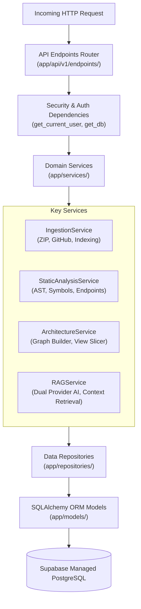

# RepoMind — Backend Architecture

## 1. Architectural Style

The RepoMind backend is built on **FastAPI 0.115** and follows a modular **Layered Domain Architecture** (Controller -> Service -> Repository -> Data Model).



## 2. Directory Hierarchy

```
backend/app/
├── ai/             # AI provider abstractions (Ollama, Gemini, Manager)
├── analysis/       # AST & Tree-Sitter parsers, ModuleResolver
├── api/            # API v1 routes, dependencies, schemas
├── core/           # Configuration, exceptions, middleware, logging
├── db/             # Base declarative classes, session lifecycle
├── models/         # SQLAlchemy ORM database models
├── repositories/   # Async data access repositories (CRUD & queries)
├── schemas/        # Pydantic validation and serialization schemas
├── services/       # Domain business logic orchestration
└── utils/          # Formatting and utility helpers
```

## 3. Key Services & Design Patterns

1. **`ArchitectureService` & `ArchitectureGraphBuilder`**:
   - Compiles parsed repository files, symbols, imports, and endpoints into an interconnected graph.
   - Computes non-overlapping 2D layout coordinates for responsive rendering.
   - Slices graphs into 6 distinct view modes.
   - Persists graph snapshots to `architecture_snapshots`.

2. **`StaticAnalysisService`**:
   - Parses code files in isolated sandboxes.
   - Extracts functions, methods, classes, signatures, parameters, docstrings, imports, and endpoints.
   - Caps parsed file size at 2 MB to prevent memory spikes on Render.

3. **`RAGService`**:
   - Retrieves semantic chunks via vector cosine similarity.
   - Injects repository context into grounded system prompts.
   - Dispatches inference to InstaBox Ollama with automated Gemini fallback.

4. **`ExecutionFlowService` & `ExecutionFlowGraphBuilder`**:
   - Parses function and method call expressions via AST and Tree-sitter.
   - Resolves caller-callee bindings locally and cross-file via `ModuleResolver`.
   - Discovers application entry points (API endpoints, CLI commands, background jobs, frontend handlers).
   - Generates bounded directed call graphs (`max_depth = 5`, `max_nodes = 50`) and caches snapshots.

5. **`ExecutionExplainerService`**:
   - Grounds execution flows against static call traces and source code lines.
   - Synthesizes plain-English summaries, step explanations, and explicit static analysis limitations using Ollama/Gemini.
