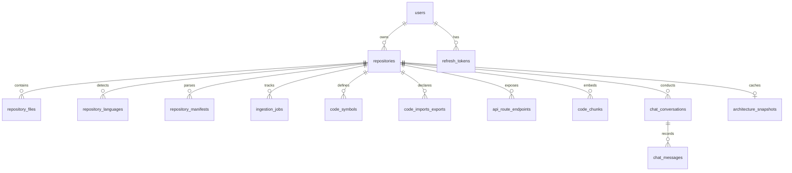

# RepoMind — Database Schema

## 1. Schema Overview

RepoMind employs a normalized relational database schema managed via **SQLAlchemy 2.0 (Async)** and **Alembic**.

## 2. Table Specifications

### `repositories`
- `id` (VARCHAR(36), PK): UUID.
- `owner_id` (VARCHAR(36), FK -> users.id).
- `name` (VARCHAR(255)), `owner` (VARCHAR(255)), `repository_url` (VARCHAR(500)).
- `default_branch`, `current_commit_sha`, `visibility`, `status`.
- `file_count`, `folder_count`, `last_analyzed_at`.

### `code_symbols`
- `id` (VARCHAR(36), PK).
- `repository_id` (VARCHAR(36), FK -> repositories.id).
- `file_id` (VARCHAR(36), FK -> repository_files.id).
- `name`, `symbol_type` (function, method, class, interface, enum, struct).
- `start_line`, `end_line`, `signature`, `docstring`, `parameters`, `return_type`.
- `is_async`, `is_exported`, `visibility`, `confidence`.

### `code_imports_exports`
- `id` (VARCHAR(36), PK).
- `repository_id` (VARCHAR(36), FK -> repositories.id).
- `file_id` (VARCHAR(36), FK -> repository_files.id).
- `statement_type` ("import" or "export").
- `source_module` (VARCHAR(500)), `symbol_name`, `alias`, `is_relative`, `line_number`.

### `api_route_endpoints`
- `id` (VARCHAR(36), PK).
- `repository_id` (VARCHAR(36), FK -> repositories.id).
- `file_id` (VARCHAR(36), FK -> repository_files.id).
- `http_method` (GET, POST, etc.), `path`, `handler_name`, `framework`, line numbers.

### `architecture_snapshots` *(New in Phase 6)*
- `id` (VARCHAR(36), PK).
- `repository_id` (VARCHAR(36), FK -> repositories.id, UNIQUE).
- `graph_data_json` (TEXT): Full serialized `ArchitectureGraphData` JSON payload.
- `node_count` (INTEGER), `edge_count` (INTEGER).
- `analyzed_at` (TIMESTAMP WITH TIME ZONE).
