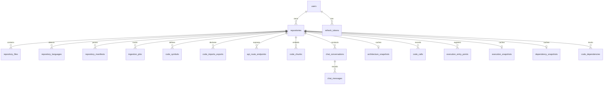

# RepoMind — Database Schema

## 1. Schema Overview

RepoMind employs a normalized relational database schema managed via **SQLAlchemy 2.0 (Async)** and **Alembic**.

## 2. Table Specifications

### `repositories`
- `id` (VARCHAR(36), PK): UUID.
- `owner_id` (VARCHAR(36), FK -> users.id).
- `name` (VARCHAR(255)), `owner` (VARCHAR(255)), `repository_url` (VARCHAR(500)).
- `default_branch`, `current_commit_sha`, `visibility`, `status`.
- `file_count`, `folder_count`, `last_analyzed_at`.

### `code_symbols`
- `id` (VARCHAR(36), PK).
- `repository_id` (VARCHAR(36), FK -> repositories.id).
- `file_id` (VARCHAR(36), FK -> repository_files.id).
- `name`, `symbol_type` (function, method, class, interface, enum, struct).
- `start_line`, `end_line`, `signature`, `docstring`, `parameters`, `return_type`.
- `is_async`, `is_exported`, `visibility`, `confidence`.

### `code_imports_exports`
- `id` (VARCHAR(36), PK).
- `repository_id` (VARCHAR(36), FK -> repositories.id).
- `file_id` (VARCHAR(36), FK -> repository_files.id).
- `statement_type` ("import" or "export").
- `source_module` (VARCHAR(500)), `symbol_name`, `alias`, `is_relative`, `line_number`.

### `api_route_endpoints`
- `id` (VARCHAR(36), PK).
- `repository_id` (VARCHAR(36), FK -> repositories.id).
- `file_id` (VARCHAR(36), FK -> repository_files.id).
- `http_method` (GET, POST, etc.), `path`, `handler_name`, `framework`, line numbers.

### `architecture_snapshots` *(New in Phase 6)*
- `id` (VARCHAR(36), PK).
- `repository_id` (VARCHAR(36), FK -> repositories.id, UNIQUE).
- `graph_data_json` (TEXT): Full serialized `ArchitectureGraphData` JSON payload.
- `node_count` (INTEGER), `edge_count` (INTEGER).
- `analyzed_at` (TIMESTAMP WITH TIME ZONE).

### `code_calls` *(New in Phase 7)*
- `id` (VARCHAR(36), PK).
- `repository_id` (VARCHAR(36), FK -> repositories.id).
- `file_id` (VARCHAR(36), FK -> repository_files.id).
- `caller_symbol_id` (VARCHAR(36), FK -> code_symbols.id, Nullable).
- `callee_symbol_id` (VARCHAR(36), FK -> code_symbols.id, Nullable).
- `caller_symbol_name` (VARCHAR(255)).
- `callee_name` (VARCHAR(255)).
- `call_type` (VARCHAR(50)): `function`, `method`, `api`, `external`, `database`.
- `resolution_status` (VARCHAR(50)): `verified`, `inferred`, `unresolved`, `external`.
- `line_number`, `end_line_number` (INTEGER).
- `call_snippet` (TEXT).
- `confidence` (VARCHAR(50)): `high`, `medium`, `low`.

### `execution_entry_points` *(New in Phase 7)*
- `id` (VARCHAR(36), PK).
- `repository_id` (VARCHAR(36), FK -> repositories.id).
- `file_id` (VARCHAR(36), FK -> repository_files.id).
- `symbol_id` (VARCHAR(36), FK -> code_symbols.id, Nullable).
- `name` (VARCHAR(255)).
- `entry_point_type` (VARCHAR(50)): `api-endpoint`, `startup-file`, `main-function`, `cli-command`, `background-job`, `ui-event`.
- `file_path` (VARCHAR(1000)).
- `line_number` (INTEGER).
- `http_method` (VARCHAR(20), Nullable).
- `route_path` (VARCHAR(500), Nullable).
- `is_verified` (BOOLEAN).
- `description` (TEXT, Nullable).

### `execution_snapshots` *(New in Phase 7)*
- `id` (VARCHAR(36), PK).
- `repository_id` (VARCHAR(36), FK -> repositories.id, UNIQUE).
- `workspace_data_json` (TEXT): Full serialized `ExecutionWorkspaceResponse` JSON payload.
- `trace_count` (INTEGER).
- `function_count` (INTEGER).
- `analyzed_at` (TIMESTAMP WITH TIME ZONE).

### `dependency_snapshots` *(New in Phase 8)*
- `id` (VARCHAR(36), PK).
- `repository_id` (VARCHAR(36), FK -> repositories.id, UNIQUE).
- `graph_data_json` (TEXT): Full serialized `DependencyAnalysisData` JSON payload.
- `total_modules` (INTEGER), `total_imports` (INTEGER).
- `internal_count` (INTEGER), `external_count` (INTEGER).
- `circular_count` (INTEGER), `unresolved_count` (INTEGER).
- `analyzed_at` (TIMESTAMP WITH TIME ZONE).

### `code_dependencies` *(New in Phase 8)*
- `id` (VARCHAR(36), PK).
- `repository_id` (VARCHAR(36), FK -> repositories.id).
- `source_file_id` (VARCHAR(36), FK -> repository_files.id).
- `target_file_id` (VARCHAR(36), FK -> repository_files.id, Nullable).
- `source_path` (VARCHAR(500)), `target_path` (VARCHAR(500), Nullable), `target_module` (VARCHAR(500)).
- `dependency_type` (VARCHAR(50)): `file`, `module`, `package`.
- `category` (VARCHAR(20)): `internal`, `external`, `unresolved`.
- `statement_type` (VARCHAR(20)): `import`, `require`, `export`.
- `imported_symbols_json` (TEXT): JSON array of imported identifiers.
- `line_number` (INTEGER).
- `is_circular` (BOOLEAN).
- `confidence` (VARCHAR(20)): `verified`, `inferred`.
