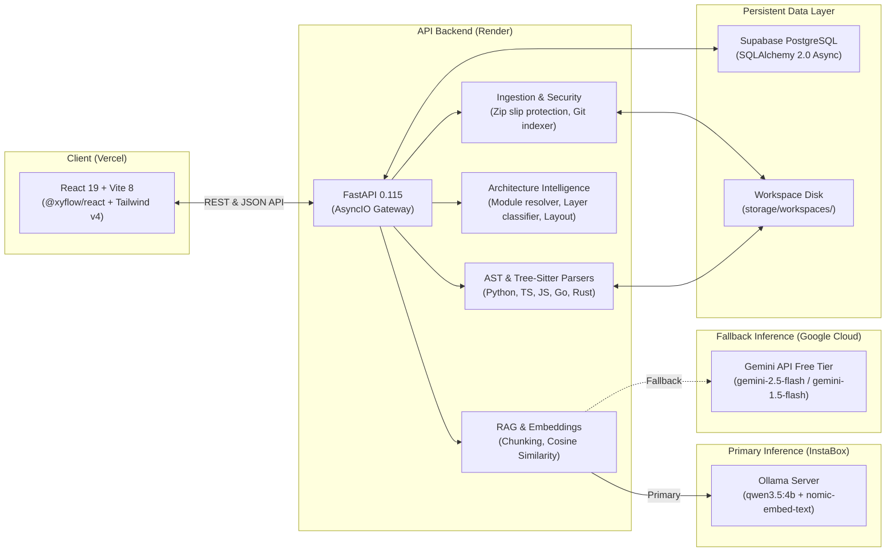

# RepoMind — System Architecture

## 1. High-Level Topology

RepoMind is a cloud-native repository intelligence platform that combines AST static code analysis, semantic RAG retrieval, and interactive graph exploration.

## 2. Layer Responsibilities

1. **Frontend Presentation Layer (`src/`)**:
   - Single-page React 19 application bundled with Vite.
   - Interactive graphs powered by `@xyflow/react` v12.
   - TanStack React Query for data fetching and optimistic UI caching.
   - Zustand stores for user session, active repositories, and theme preferences.

2. **Backend Application Layer (`backend/app/`)**:
   - FastAPI application structured with layered domain services.
   - Dependency injection for database sessions and authentication (`get_current_user`, `get_db`).
   - Standardized exception handlers and correlation ID middleware.

3. **Intelligence & Analysis Layer**:
   - Python AST standard library parser for Python.
   - Tree-sitter multi-language parser for JavaScript, TypeScript, Java, Go, Rust, C/C++, C#, and PHP.
   - Module resolution engine for cross-file path resolution.
   - Architecture classifier and DAG layout engine.

4. **Persistence Layer**:
   - Async SQLAlchemy with PostgreSQL (production on Render) and SQLite (local dev/test).
   - Dedicated tables for files, symbols, imports, endpoints, chunks, chat messages, and architecture snapshots.
